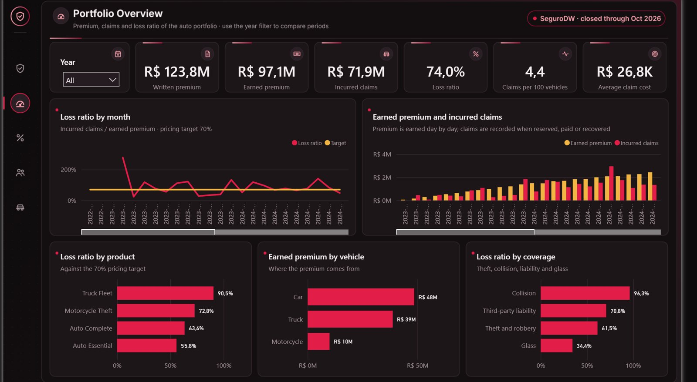
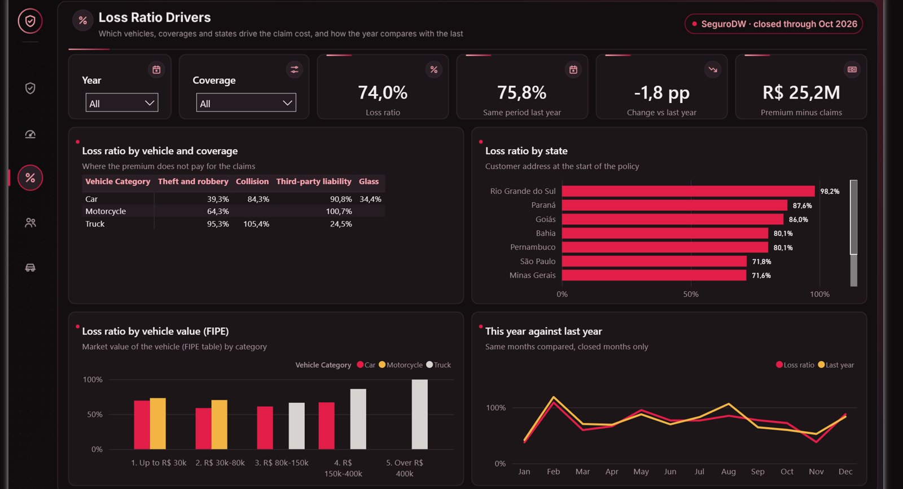
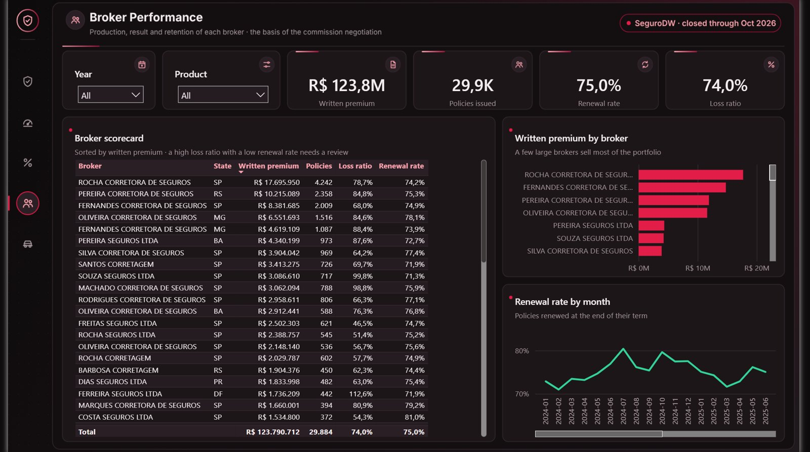
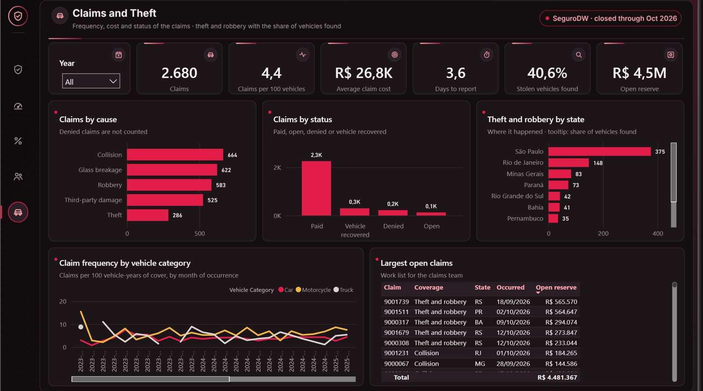
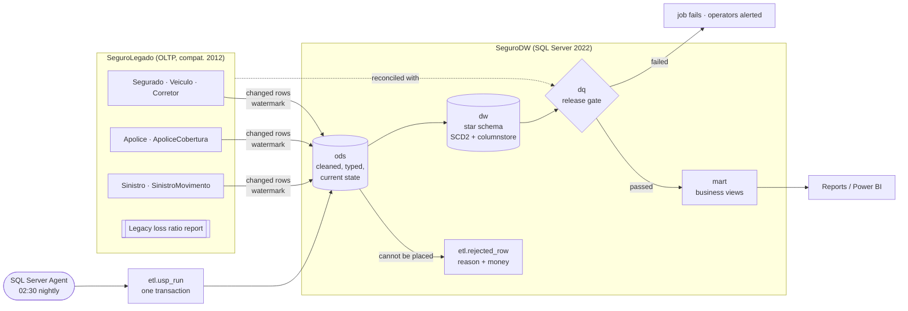
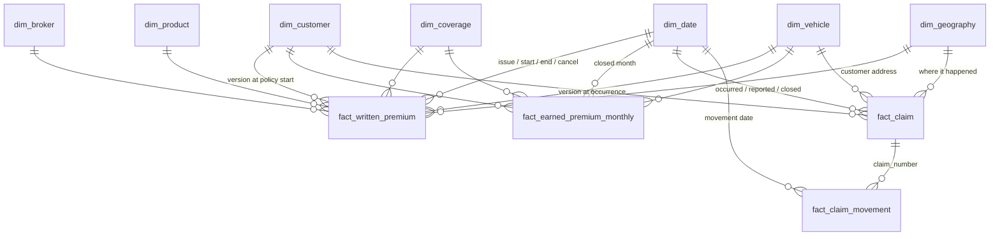

# Auto Insurance Data Warehouse (SQL Server)

[](https://github.com/vitorchavernue/auto-insurance-data-warehouse/actions/workflows/ci.yml)

Restructuring of a **slow legacy SQL Server** used by an auto insurer: management reports ran directly on the
policy system, with row-by-row functions, and competed with the operation for the same server. The project builds
an **ODS** and a **star-schema data warehouse** next to it, loaded by **incremental T-SQL procedures**, checked by a
**data quality gate** and scheduled by **SQL Server Agent**.

What it shows:

- **Legacy cleaning in the ODS**: CPFs that lost their leading zeros, dates stored as text, vehicle categories typed
  by hand, invalid state codes, claims typed with a wrong policy number — fixed, flagged or rejected with a reason
- **Dimensional model** with three kinds of fact table (transaction, periodic snapshot, accumulating snapshot) and an
  **SCD type 2** customer dimension (the address decides the risk region)
- **Incremental loads by watermark**, idempotent `MERGE`, retries of rejected records, and the whole run in **one
  transaction** (it lands completely or not at all)
- **Release gate**: premium, earned premium and claim money reconciled with the legacy system to the cent
- **Before/after benchmark**: the original report against the warehouse — same numbers, a fraction of the work
- **Power BI dashboard** fed by the warehouse: loss ratio, frequency, severity, broker scorecard, renewals and theft
  recovery, built as code (PBIP/TMDL) and checked in CI
- **CI on a real SQL Server 2022** (with SQL Server Agent) on every push

> All data is synthetic (fixed random seed): 15,000 customers, 30,000 policies, 77,000 coverages, 2,900 claims,
> with the defects of a 15-year-old system planted on purpose.

---

## Results

**Before/after** — loss ratio report for 2026 (10 closed months × vehicle category × coverage), cold cache:

| | Legacy report (OLTP, scalar functions) | Warehouse (star schema, columnstore) | |
|---|---:|---:|---:|
| Logical reads (8 KB pages) | 5,769,031 | 9,489 | **608× less** |
| CPU time | 8.1–12.7 s | 0.6–0.8 s | **13–17× less** |
| Elapsed time | 9–14 s | 0.5–2.2 s | **6–21× faster** |
| Result | 90 lines | 90 lines | **✅ identical, line by line** |

Logical reads are the same on every run; times vary with the shared CI runner (ranges of the CI runs, each one
published in the job summary).

The legacy report is kept in [`sql/legacy/02_loss_ratio_report.sql`](sql/legacy/02_loss_ratio_report.sql) exactly as it
was found: a month-by-month loop, scalar functions that read the policy again for every row, `YEAR()` on columns.
The warehouse answers the same question from [`mart.vw_loss_ratio_monthly`](sql/dw/09_marts.sql).

**First load** (full, as of 30/09/2026): about 145,000 legacy rows → 74,871 premium rows, 762,494 earned-premium rows
(policy × coverage × month since 2023) and 2,784 claims, with 401 records rejected with a reason and every money check
passed.

**Release gate** after one month of business (incremental run, as of 31/10/2026):

| Check | Result | Legacy | Warehouse |
|---|---|---:|---:|
| Every policy coverage is loaded or rejected | ✅ | 77,456 | 77,125 loaded + 331 rejected |
| Written premium matches the legacy system | ✅ | 123,790,711.65 | 123,790,711.65 |
| Earned premium matches a recalculation from the legacy system | ✅ | 97,148,814.52 | 97,148,814.52 |
| Claim movements (reserves, payments, recoveries) match | ✅ | 74,181,724.90 | 74,181,724.90 |
| Every claim is loaded or rejected | ✅ | 2,910 | 2,902 loaded + 8 rejected |
| No coverage earns more than its premium · claim totals agree with movements · customer history consistent · no orphan keys · fact grain unique | ✅ | | |
| Customers with an invalid CPF (loaded and flagged for the registration team) | ⚠️ info | | 107 |
| Claims outside the policy period (flagged for the claims team) | ⚠️ info | | 17 · R$ 506,598.95 |
| Rejected records waiting for a fix at the source | ⚠️ info | | 383 · R$ 277,940.28 |

The incremental run reads only what changed in the month (491 customers, 929 policies, 317 claim movements out of
~150,000 legacy rows) and adds October to the earned premium of every policy in force.

---

## Dashboard (Power BI)


| Page | What it answers |
|---|---|
| **Portfolio overview** | Is the portfolio profitable? Written and earned premium, incurred claims, loss ratio against the 70% target, frequency and average claim cost, month by month |
| **Loss ratio drivers** | Where the claim cost comes from: vehicle × coverage, state, vehicle value (FIPE) and the same months of last year |
| **Broker performance** | Production, loss ratio and renewal rate of each broker — the basis of the commission negotiation |
| **Claims and theft** | Claims by cause and status, days to report, theft by state with the share of stolen vehicles found, largest open claims |





<details><summary>Broker performance and claims pages</summary>





</details>

The dashboard reads only the [`pbi` views](sql/dw/11_powerbi_views.sql) of the warehouse: facts summarised to month ×
coverage × product × vehicle profile × broker × state, business names, and no personal data (no names, CPFs or
plates). `python -m insurance_dw export` writes them as Parquet for the [`powerbi/`](powerbi/) project, and an
integration test proves the files add up to the facts to the cent. The semantic model (11 tables, 30 DAX measures with
descriptions, a marked date table for "same period last year") is TMDL in Git, the pages are generated by
[`scripts/build_report.py`](scripts/build_report.py), and [`scripts/validate_model.py`](scripts/validate_model.py) loads
the model with Microsoft's Tabular Object Model in CI and applies 16 rules (DIVIDE instead of "/", every fact filtered
by the calendar, hidden keys, every field used by a visual exists ...).

---

## Architecture



| Layer | What it holds | Why |
|---|---|---|
| **Legacy** ([`sql/legacy`](sql/legacy)) | The policy system as found: Portuguese names, text dates, no foreign keys, only primary-key indexes | The starting point; never written by the warehouse |
| **ODS** ([`03`](sql/dw/03_ods_tables.sql), [`05`](sql/dw/05_load_ods.sql)) | One table per legacy table, cleaned and typed, current state, stamped with the run that changed each row | Reports stop hitting production; the warehouse knows exactly what changed |
| **Star schema** ([`04`](sql/dw/04_star_schema.sql), [`06`](sql/dw/06_load_dimensions.sql), [`07`](sql/dw/07_load_facts.sql)) | 7 dimensions, 4 facts | Analysis by any combination of month, product, vehicle, region, broker, coverage |
| **Data quality** ([`08`](sql/dw/08_data_quality.sql)) | 10 critical + 4 info checks per run | "The job finished" is not proof; matching money is |
| **Marts** ([`09`](sql/dw/09_marts.sql)) | Loss ratio, renewal rate, broker scorecard, theft recovery | One official definition per indicator |
| **Power BI feed** ([`11`](sql/dw/11_powerbi_views.sql)) | Summarised facts and dimensions with business names | The dashboard depends on these views only, with no personal data |
| **Orchestration** ([`10`](sql/dw/10_run.sql), [`jobs`](sql/jobs/nightly_job.sql)) | `etl.usp_run` + Agent job | One call, one transaction, a clear status |

## Dimensional model



| Fact | Type | Grain | Answers |
|---|---|---|---|
| `fact_written_premium` | Transaction | Policy × coverage | Production: premium sold, renewals, cancellations |
| `fact_earned_premium_monthly` | Periodic snapshot (columnstore) | Policy × coverage × closed month | Earned premium and exposure (vehicle-years): the base of loss ratio and frequency |
| `fact_claim` | Accumulating snapshot | Claim | Lifecycle: report lag, status, paid, open reserve, recovered, incurred |
| `fact_claim_movement` | Transaction (columnstore) | Reserve / payment / recovery | Incurred claims by month |

Business definitions (the same in the legacy report and in the warehouse):
**earned premium** = premium × days in force in the month ÷ days of the term (a cancellation stops it);
**incurred claims** = payments + reserve changes − recoveries; **loss ratio** = incurred ÷ earned;
**frequency** = claims per 100 vehicle-years; **severity** = incurred ÷ claims.

Design decisions: [ODS + star schema next to the legacy system](docs/adr/0001-ods-and-star-schema.md) ·
[ETL in T-SQL, one transaction per run](docs/adr/0002-tsql-etl-single-transaction.md) ·
[customer address as SCD type 2](docs/adr/0003-customer-address-scd2.md). Operations: [runbook](docs/runbook.md).

---

## How the incremental load works

1. **Read** only legacy rows changed since the last run (watermark per table, 5-minute overlap for late commits),
   plus rows rejected before — retried until the business fixes them at the source.
2. **Clean** with set-based inline functions ([`02`](sql/dw/02_cleaning_functions.sql)): CPF check digits, text dates,
   mapping tables for hand-typed codes.
3. **Upsert** with `MERGE`, only when a value really changed and the source is not older — running twice changes
   nothing (tested).
4. **Refresh only what changed** in the warehouse: policies and claims touched in the run are rebuilt; each newly
   closed month is added for every policy in force; a late cancellation recalculates the months already earned;
   a customer who moves gets a new version, and old policies keep the address they were sold with.
5. **Check** and set the status: `passed`, `failed` (gate) or `error` (rolled back, watermarks included).

## Tests and CI

- **Unit** — the synthetic data: determinism, valid CPFs, annual terms, every claim reserve closed, planted defects.
- **Integration on SQL Server 2022**, in order: first load passes the gate → running again touches 0 rows → one month
  of business → incremental run → customer history (SCD2) → a late cancellation reduces the premium already earned
  → fixed records leave the rejected list → **the warehouse returns exactly the legacy report** → a manual edit in the
  warehouse **fails the gate** and a full run repairs it → **an error rolls the whole run back** → the Agent job is created.
- **Power BI** — the dashboard quality gate (16 rules on the model loaded with the Tabular Object Model) and tests
  that it catches a ratio divided with "/" and a fact table not filtered by the calendar.
- **GitHub Actions**: ruff, a T-SQL syntax gate (sqlfluff parser), unit tests, integration tests, the full-scale demo
  and benchmark published in the job summary, and the Power BI quality gate.

## Run it

```bash
cp .env.example .env     # SQL Server connection (sa password)
make setup               # Python dependencies (the load itself is T-SQL)
make up                  # SQL Server 2022 + Agent in Docker
make demo                # deploy -> first load (30/09/2026) -> a month of business -> incremental load -> benchmark
make test test-integration
python -m insurance_dw export --out powerbi/data   # then open powerbi/InsurancePerformance.pbip in Power BI Desktop
```

```sql
-- In SeguroDW
EXEC etl.usp_run @as_of_date = '2026-10-31';                 -- incremental run
EXEC etl.usp_run @as_of_date = '2026-10-31', @mode = 'full'; -- re-read everything and rebuild the facts
SELECT * FROM dq.check_result WHERE run_id = (SELECT MAX(run_id) FROM etl.run);
SELECT * FROM mart.vw_loss_ratio_monthly WHERE year = 2026 ORDER BY month, category_code, coverage_code;
```

## Project structure

```
sql/legacy/       01 legacy tables · 02 original loss ratio report (kept for the benchmark)
sql/dw/           01 schemas, control and reference tables · 02 cleaning functions · 03 ODS · 04 star schema
                  05 ODS load · 06 dimensions · 07 facts · 08 data quality gate · 09 marts · 10 orchestrator
                  11 Power BI feed (pbi views)
sql/jobs/         SQL Server Agent nightly job
src/insurance_dw/ seed.py (synthetic legacy data) · deploy.py · run.py · benchmark.py · export.py · CLI
powerbi/          Insurance Performance dashboard (PBIP: TMDL model + report pages) and its data
scripts/          build_report.py (report as code) · validate_model.py (dashboard quality gate)
tests/            unit · integration (real SQL Server) · powerbi
docs/             ADRs · runbook
```

## Stack

**SQL Server 2022** · **T-SQL** (stored procedures, `MERGE`, inline TVFs, window functions) · **columnstore** ·
**SQL Server Agent** · **dimensional modeling** (Kimball, SCD2) · **Python** (pymssql, pytest) · **Docker** ·
**GitHub Actions** · **sqlfluff** · **Power BI** (PBIP, TMDL, DAX) · **Parquet**
